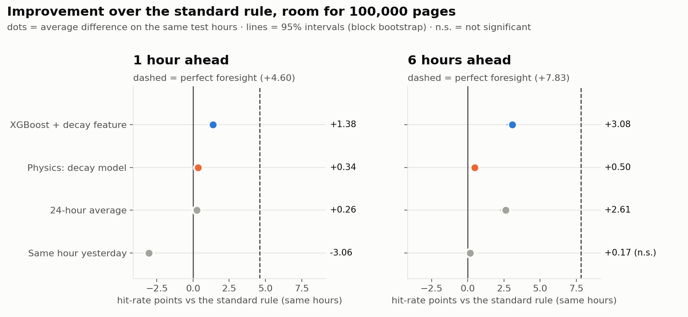
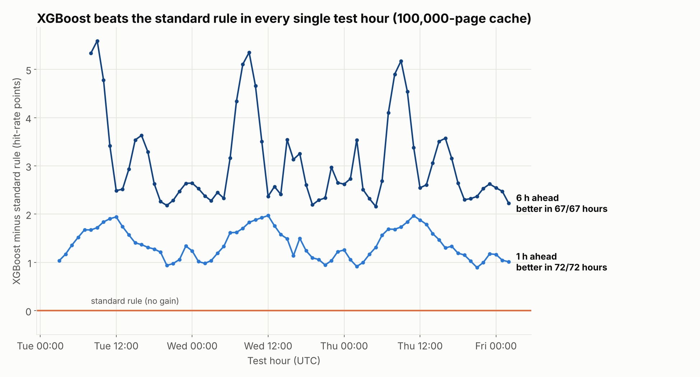
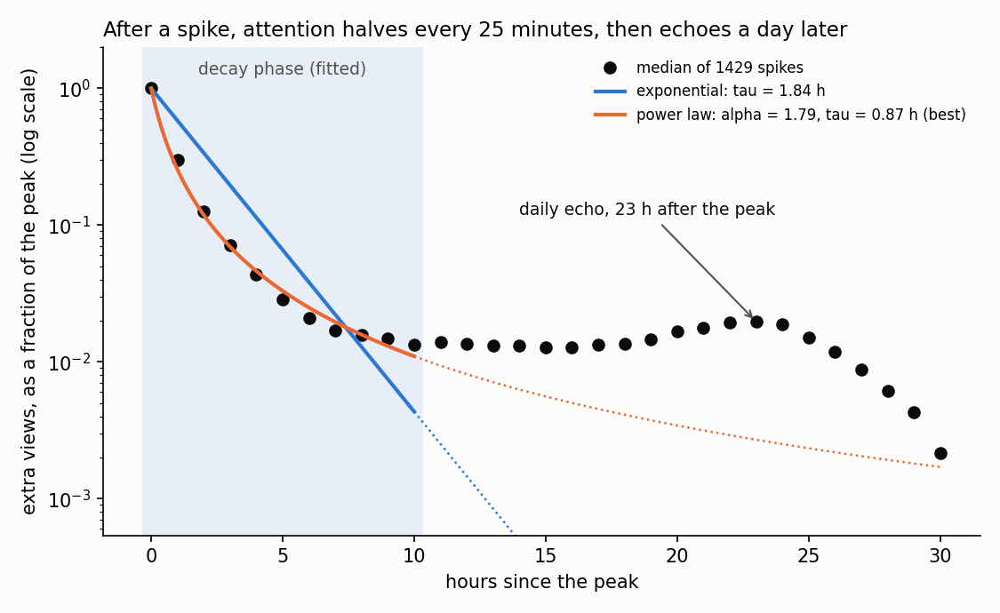

# Cachanium 

**Predicting what Wikipedia will read next hour, to make better caching decisions.**

Every Wikipedia page view is served either from a fast cache or, more slowly, from the main servers. Suppose a cache holds the top **100,000** English articles and is refilled once an hour. Which articles should it hold? The standard answer is "whatever was popular last hour". We forecast the next hours instead, with a fitted model of how attention decays after a spike and an XGBoost model that uses that decay as a feature.

Because a cache doesn't change what people read, replaying real history gives an exact backtest. Every method is scored on **72 hours of English Wikipedia traffic (20–23 Oct 2026) that no model saw during training**.

> **Headline (100,000-page cache, 1 hour ahead):** XGBoost serves **86.6%** of views from cache against **85.2%** for the standard rule: **9.4% fewer requests reach the main servers**, about **30% of the gap to perfect foresight** is recovered, and XGBoost is ahead in **every one of the 72 test hours**. Deciding 6 hours ahead, the lead grows to **+3.1 points (17.1% fewer misses)**.



## Contents

- [Results](#results-cache-of-100000-pages)
- [Interactive demo](#interactive-demo)
- [Repository map](#repository-map)
- [Where to start](#where-to-start)
- [Reproducing the results](#reproducing-the-results)
- [How it works](#how-it-works)
- [Limitations](#limitations)
- [Future work](#future-work)
- [Team and acknowledgements](#team-and-acknowledgements)

---

## Results (cache of 100,000 pages)

All numbers are for English Wikipedia, desktop and mobile combined. Intervals are 95% block-bootstrap intervals over hours. The full list is in [`out/charts_100k/key_numbers.md`](out/charts_100k/key_numbers.md), and the raw scores are in [`out/results.csv`](out/results.csv).

### Hit rate: share of views served from cache

| Method | 1 h ahead | 95% interval | 6 h ahead |
|---|---|---|---|
| Perfect foresight (ceiling) | 89.8% | 89.7–90.0% | 89.8% |
| **XGBoost + decay feature** | **86.6%** | 86.4–86.8% | **85.1%** |
| Decay model (physics-based) | 85.6% | 85.3–85.8% | 82.5% |
| 24-hour average | 85.5% | 85.3–85.7% | 84.6% |
| Last hour (standard rule) | 85.2% | 85.0–85.5% | 82.0% |
| Same hour yesterday | 82.2% | 81.9–82.5% | 82.2% |

Compared with the standard rule on the same hours (paired, 1 hour ahead):

| Method | Points above the standard rule | 95% interval | Hours ahead of it | Share of the gap to perfect foresight recovered |
|---|---|---|---|---|
| Perfect foresight | +4.60 | +4.27 to +5.04 | 100% | 100% |
| **XGBoost + decay feature** | **+1.38** | +1.26 to +1.56 | **100%** | **30%** |
| Decay model (physics-based) | +0.34 | +0.27 to +0.44 | 100% | 8% |

**What this shows:**

- **With a cache this size, prediction pays off.** The standard rule leaves 4.6 points on the table. XGBoost recovers 30% of that and is never worse in any test hour. Every improvement in the table is statistically significant.
- **The decay model alone gives a small but consistent gain**: +0.34 points, ahead in every hour. Its main value is as a feature inside XGBoost (see below).
- **"Last hour" is the most fragile rule.** Deciding 6 hours ahead, it drops to 82.0%, below even "same hour yesterday". XGBoost holds 85.1%.

### What the gain is worth: fewer misses

A hit is cheap; a miss means the main servers must build the page, so an operator's cost scales with the **miss rate**. With a 100,000-page cache, XGBoost cuts misses from 14.8% to 13.4% of all views: **9.4% fewer requests reach the main servers** deciding 1 hour ahead, and **17.1% fewer** deciding 6 hours ahead. It is ahead of the standard rule in every one of the test hours, and significantly better than each of the four simple methods in 46 of 48 method-by-setting comparisons (all 46 survive a Bonferroni correction).



The full write-up, including XGBoost against the *best* simple method in each setting, is in [`out/xgb_report/xgb_report.md`](out/xgb_report/xgb_report.md); the per-setting numbers are in [`out/value_metrics.md`](out/value_metrics.md).

### What is foresight worth?

A real cache needs time to warm up. The further ahead it must be decided, the more prediction is worth:

| Hours ahead | XGBoost vs standard rule | Decay model vs standard rule | Perfect foresight vs standard rule |
|---|---|---|---|
| 1 | +1.39 | +0.35 | +4.60 |
| 2 | +1.63 | +0.41 | +5.39 |
| 3 | +1.97 | +0.46 | +6.12 |
| 6 | **+3.08** | +0.50 | +7.82 |


### Bigger caches gain more

At 100,000 pages, both models close part of the gap. At smaller caches the standard rule is already close to the ceiling (1.2 points at 10,000 pages), so there is little left to win. XGBoost recovers 10% of the gap at 10,000 pages and 0% at 1,000. The decay model on its own is worse than the standard rule at those sizes.


| Cache size | Perfect foresight | XGBoost | Last hour (standard) | Decay model |
|---|---|---|---|---|
| 1,000 | 16.7% | 15.9% | 15.9% | 15.7% |
| 10,000 | 41.7% | 40.6% | 40.5% | 40.3% |
| **100,000** | **89.8%** | **86.6%** | **85.2%** | **85.6%** |

(Hit rate, 1 hour ahead.)

### The physics of attention

We fitted the decay of **1,429 spikes** in the training days. A spike is at least 1,000 views/hour and at least 10× the page's median over the previous 24 hours.

- **Extra attention fades like a power law, not an exponential:** excess ∝ (1 + t/τ)^−α with **α = 1.79, τ = 0.87 h**. An exponential fits clearly worse.
- **Half-life of about 25 minutes** after the peak.
- **A daily echo:** 23 hours after the peak, extra attention climbs back to about 2% of the peak, 1.5× its low point. People come back at the same time the next day.



At any moment, most pages are not decaying from a spike. That is why the decay curve helps most as a feature that tells XGBoost *how fast* a hot page is cooling.

### Spikes

With room for 100,000 pages, almost every spike page is already in the cache. Every method except "same hour yesterday" serves about 98–99% of spike pages' views in their first 6 hours (standard rule 99.2%, XGBoost 99.1%, decay model 99.1%). The median catch lag is 0 hours for all of them. So at this cache size XGBoost's advantage comes from **ordinary, non-spiking pages**, which the standard rule ranks less well.


A page that goes from nothing to a huge spike within a single hour can't be predicted from hourly data, and every method catches it an hour late. That is a limit of the data, not of the model. Example: *Tom Skerritt*, peaking at 97,628 views/hour ([chart](out/charts/7_spike_example.png)).

Results for a 10,000-page cache are in [`out/charts/`](out/charts/) and [`out/charts/key_numbers.md`](out/charts/key_numbers.md).

---

## Interactive demo

An article-style walkthrough of the results: the problem, a replay of one day of Wikipedia traffic with both methods' hit rates hour by hour, the aggregate results, and a cache-size comparison. The walkthrough runs fully offline; the live planner fetches new data when online.

```bash
pip install -r requirements.txt
uvicorn api:app --port 8000        # then open http://127.0.0.1:8000/
```

### Live cache planner

The **Live now** page (`/demo/live.html`) runs the model on the newest data. Each time Wikimedia publishes a new hour of page views (usually one to two hours after it ends), the server fetches it, chooses the cache for the next hour with XGBoost and with the standard rule, shows where they disagree, and scores both methods on the hours that have since happened. It needs the trained models (`python fit_decay.py && python train_xgb.py`).

```bash
uvicorn api:app --port 8000                                  # live: fetches recent hours, then every new one
LIVE_DOWNLOAD=0 uvicorn api:app --port 8000                  # offline: newest data already on disk
LIVE_AS_OF="2026-10-22 20:00" uvicorn api:app --port 8000    # replay a past hour as if it were now
python live.py                                               # the same plan, printed in the terminal
```

On Windows PowerShell, set the variable first: `$env:LIVE_AS_OF="2026-10-22 20:00"; uvicorn api:app --port 8000`.

No Python packages? `python -m http.server 8000` from the repository root, then open `http://127.0.0.1:8000/demo/#start` (everything except the live page works). Details, data sources and the built-in integrity check are in [`demo/README.md`](demo/README.md). The same server exposes the results as JSON (`/api/results`, `/api/hours`, `/api/spikes`; interactive docs at `/docs`).

## Repository map

```text
.
├── README.md                     you are here
├── INTERFACES.md                 data formats and contracts between pipeline stages
├── requirements.txt
│
│   Data
├── download.py                   stream Wikimedia hourly dumps → data/views.parquet
├── combine_parquets.py           merge partial downloads into one file
├── checks.py                     data-quality report: missing hours, suspected bots
├── make_fake_data.py             small synthetic data set for development
├── data/                         views.parquet lives here (not committed, see data/README.md)
│
│   Models
├── predictors/
│   ├── __init__.py               registry of every method the backtest scores
│   ├── baselines.py              last hour (standard rule), 24-hour average, same hour yesterday
│   ├── decay_predict.py          physics-based model of attention decaying after a spike
│   ├── xgb.py                    XGBoost predictor (one model per horizon)
│   └── xgb_features.py           features shared by training and prediction
├── fit_decay.py                  fit the decay curve on training spikes → models/decay_params.json
├── train_xgb.py                  train XGBoost on training hours → models/xgb_h{1,2,3,6}.json
│
│   Evaluation
├── backtest.py                   score every method on the held-out 72 hours
├── quick_check.py                fast sanity check of all predictors
├── value_metrics.py              miss reduction, paired significance, requests saved
├── make_charts.py                slide charts and key_numbers.md
├── make_xgb_report.py            XGBoost vs every simple method: report and charts
├── out/                          all results: tables, charts, reports (see out/README.md)
│   ├── results.csv               hit rates for every method × cache size × horizon
│   ├── hourly.csv                the same, for every test hour
│   ├── charts_100k/              main charts + key_numbers.md (100,000-page cache)
│   ├── charts/                   the same for 10,000 pages
│   └── xgb_report/               XGBoost vs simple methods, with paired tests
│
│   Demo
├── api.py                        local server: front end, JSON API and live planner
├── live.py                       live planner: fetches each new hour, chooses the next hour's cache
├── demo.json                     replay of 22 Oct 2026 (top pages, hit rates, spikes)
├── demo/                         front end: plain HTML/CSS/JS, no build step (live.html: live planner)
│
│   Documentation and future work
├── docs/
│   ├── Ahead of the Spike — Codebase Guide.pdf
│   └── presentation-walkthrough.md
└── future/transformer/           experimental sequence model (not in the main results)
```

## Where to start

| If you want to… | Read |
|---|---|
| See the results in two minutes | The headline above, then [`out/charts_100k/key_numbers.md`](out/charts_100k/key_numbers.md) |
| Check the statistics | [`out/xgb_report/xgb_report.md`](out/xgb_report/xgb_report.md) and [`out/value_metrics.md`](out/value_metrics.md) |
| Try it | The [interactive demo](#interactive-demo), including the live cache planner |
| Understand the method | [How it works](#how-it-works), then [`INTERFACES.md`](INTERFACES.md) |
| Read the code | [`backtest.py`](backtest.py) (the evaluation), then [`predictors/baselines.py`](predictors/baselines.py), [`predictors/xgb_features.py`](predictors/xgb_features.py) and [`predictors/decay_predict.py`](predictors/decay_predict.py); a walkthrough is in the [codebase guide](docs/Ahead%20of%20the%20Spike%20%E2%80%94%20Codebase%20Guide.pdf) |
| Add a new method | [`INTERFACES.md` section 3](INTERFACES.md#3-predictors): write one `predict()` function and register it in `predictors/__init__.py` |

## Reproducing the results

```bash
pip install -r requirements.txt

# 1. Data: real (several hours to download) or synthetic
python download.py --start "2026-10-18 00:00" --end "2026-10-23 02:00"
python checks.py                     # missing hours, suspected bots
python make_fake_data.py             # alternative: synthetic data for development

# 2. Fit the decay model and train XGBoost (training hours only)
python fit_decay.py                  # -> models/decay_params.json, out/decay_fit.png
python train_xgb.py                  # -> models/xgb_h{1,2,3,6}.json

# 3. Score every method on the held-out 3 days
python backtest.py                   # -> out/results.csv, out/hourly.csv, out/demo.json

# 4. Charts, key numbers and statistics
python make_charts.py --cache-size 100000 --out out/charts_100k
python make_charts.py                # 10,000-page cache -> out/charts/
python value_metrics.py              # add --data data/views.parquet for cache-size equivalents
python make_xgb_report.py            # -> out/xgb_report/
```

On synthetic data use small cache sizes, since it has only 3,000 pages: `python backtest.py --sizes 100 300 1000 --demo-size 300`. If several machines downloaded different hours, merge them with `python combine_parquets.py data/views.parquet other.parquet`.

## How it works

```
download.py ─► data/views.parquet ─► fit_decay.py ─► train_xgb.py ─► backtest.py ─► out/ ─► make_charts.py
                hour, page, views                                         │                  value_metrics.py
                                                                          └─► demo.json ─► demo/ (via api.py)
```

- **Data.** `download.py` streams Wikimedia's hourly pageview dumps and keeps only English desktop (`en`) and mobile (`en.m`) views, summed. It drops non-article pages and saves each hour as soon as it is processed, so an interrupted download loses at most one hour. Raw files are never kept.
- **Predictors.** Every method is a single function, `predict(history, now, horizon) -> pd.Series` of predicted views per page. It only ever receives rows with `hour <= now`, and is registered in `predictors/__init__.py`.
  - `baselines.py`: last hour (the standard rule, ≈ LRU), 24-hour average (≈ LFU), same hour yesterday.
  - `decay_predict.py`: baseline + current excess × f(t + h)/f(t), where f is the fitted decay curve.
  - `xgb.py` / `xgb_features.py`: XGBoost on recent views, differences, peak timing, hour and weekday, plus the decay model's forecast. One model per horizon; training and prediction share the same feature code.
- **Backtest.** For each test hour, method, cache size (1k / 10k / 100k) and horizon (1, 2, 3, 6 h), `backtest.py` caches the top *N* predicted pages and scores the share of actual views at hour `now + h` that land in the cache. It also runs the perfect-foresight ceiling, measures spike catch times and bootstraps intervals.
- **No leakage.** The last 3 days are the test period; `fit_decay.py` and `train_xgb.py` use only hours before it.
- **Statistics.** Methods are compared on the same hours (paired). Intervals use a block bootstrap over 6-hour blocks, because neighbouring hours are correlated; `value_metrics.py` and `make_xgb_report.py` add exact sign tests and a Bonferroni correction.

## Limitations

- **Hourly decisions.** Real caches decide per request. This is a simplified model of caching, though an exact backtest of that model.
- **Every page counts as the same size.** Article sizes aren't in the pageview data, so "100,000 pages" is a page count, not a byte budget.
- **About five days of data.** The test period is 3 days, so weekly patterns aren't captured.
- **Bots aren't removed.** `checks.py` flags pages with automated-looking traffic but excludes nothing.

## Future work

- **A transformer forecaster.** An experimental model that reads each page's last 48 hours is in [`future/transformer/`](future/transformer/). In one run it roughly matched XGBoost, and averaging the two edged ahead of XGBoost alone in every setting. More weeks of training data is the next step.
- **Per-request evaluation** with Wikimedia's anonymised caching-server request traces ([T225538](https://phabricator.wikimedia.org/T225538)).
- **Byte-weighted caching**, once article sizes are joined in.
- **Switching costs**: choosing cache contents to maximise hits minus the bandwidth cost of swapping pages.

## Team and acknowledgements

Built at OxHacks 2026 (theme: *Time*; track: best use of data for prediction and decision making) by Anay Gupta, Thomas Meeson, Omar Hyder, and Musa Ali (a team of second-year Imperial students in Computing, Physics, Electronic and Information Engineering, and Design Engineering).

Data: [Wikimedia hourly pageviews](https://dumps.wikimedia.org/other/pageviews/) ([readme](https://dumps.wikimedia.org/other/pageviews/readme.html)), released under CC0.
